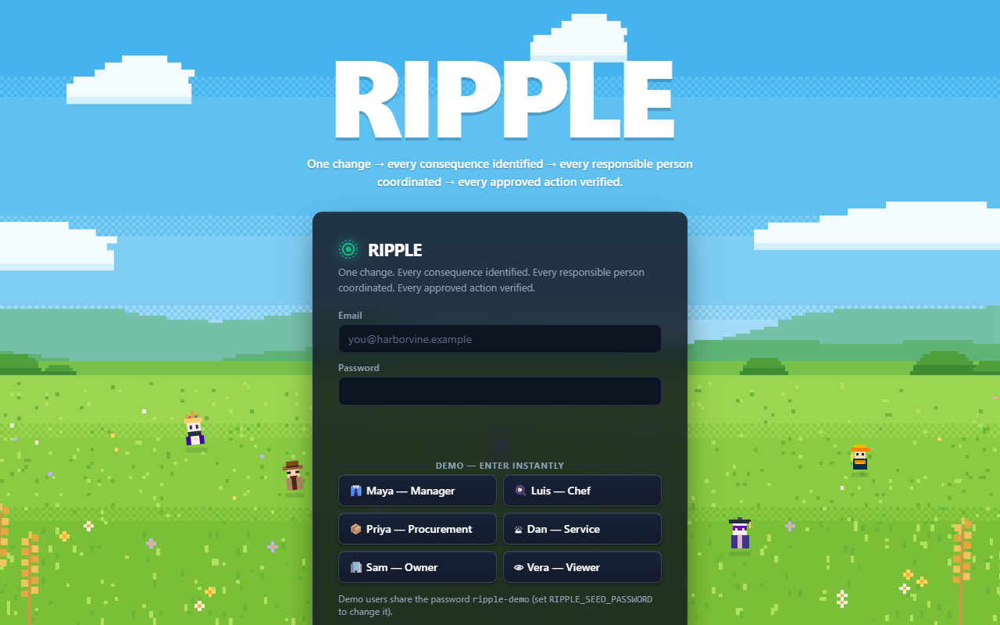
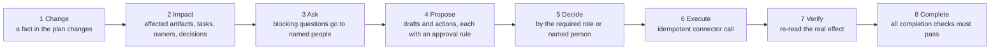
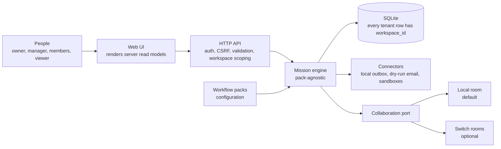
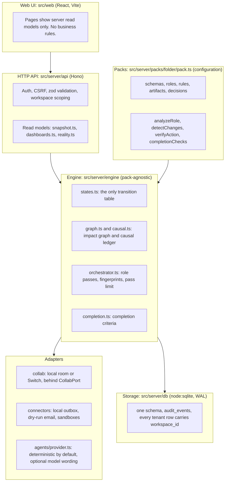
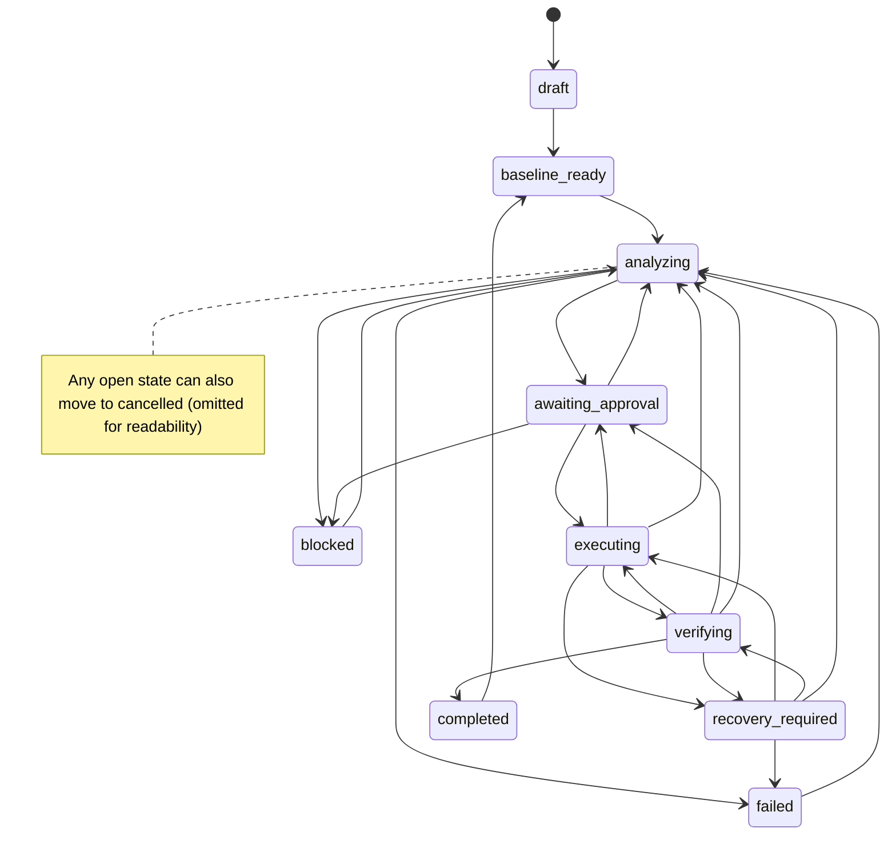
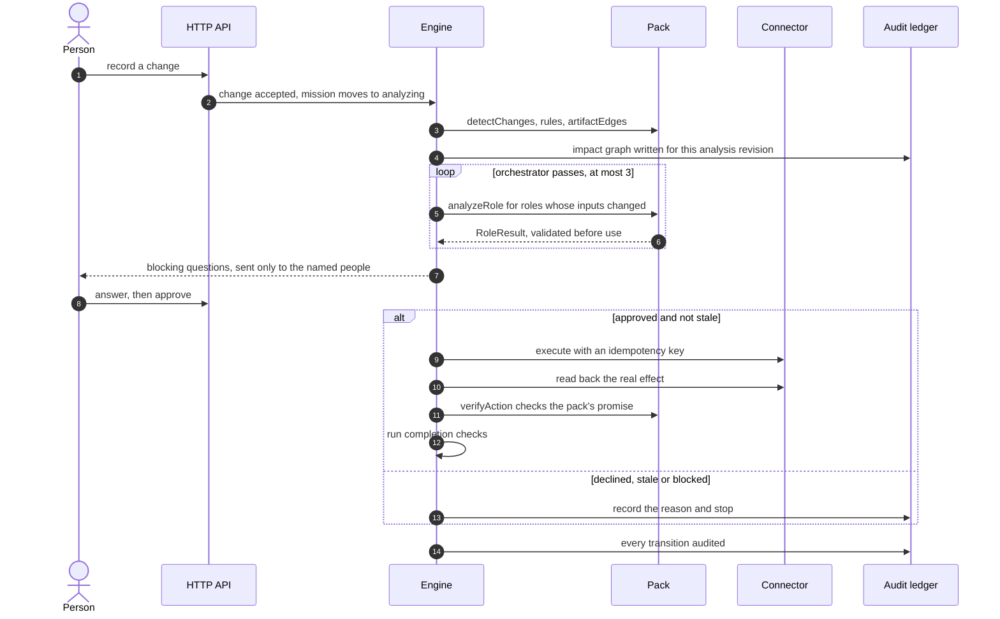
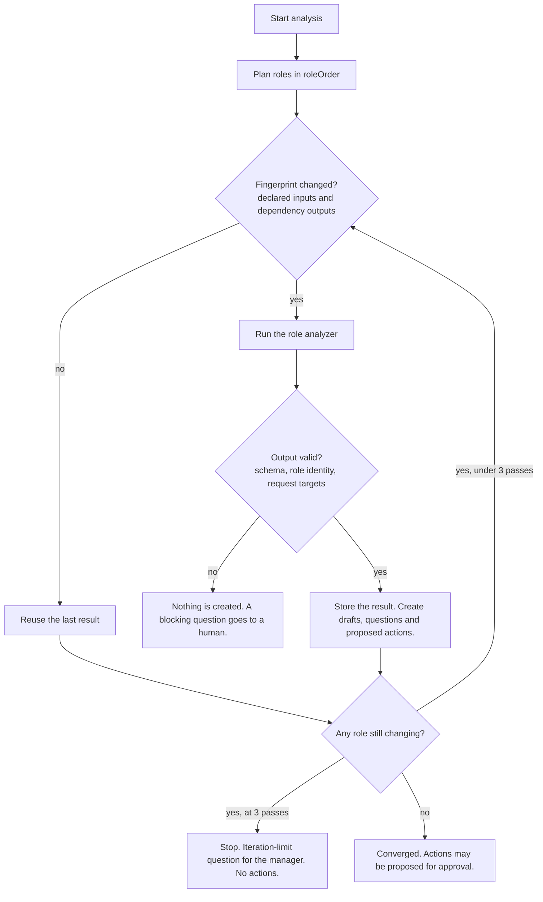

# RIPPLE

**One change → every consequence found → every responsible person asked → every approved action independently verified.**

RIPPLE is a workflow platform for any process where a single change creates work for several people. You record the change. RIPPLE works out what it touches, asks the named person for each decision, runs only what was approved, and re-reads the real result before it marks anything done.

It is one engine with one data model and one approval and evidence ledger. A domain is configuration: a **workflow pack**. Each pack is one TypeScript object that describes its data, its roles and its rules. None of the packs has its own app, database or approval logic. The packs in this repository are listed below, generated from the code.

RIPPLE is not a chatbot, a generic task manager, or an automation that sends email, posts messages or moves money. Everything that would leave the system goes through a local, dry-run connector.

---

## Contents

- [The loop](#the-loop)
- [Worked example](#worked-example)
- [Architecture](#architecture)
- [Rules the engine enforces](#rules-the-engine-enforces)
- [Adding a domain](#adding-a-domain)
- [Workflow packs](#workflow-packs)
- [Verification status](#verification-status)
- [Switch integration](#switch-integration)
- [Known limitations](#known-limitations)
- [Run it](#run-it)
- [Repository map](#repository-map)
- [Package Gate](#package-gate)

---

## The loop



Steps 3 to 5 can repeat. A new answer or change starts a new analysis revision, and any action built on the old revision becomes stale and cannot be decided or executed.

## Worked example

This is the run-of-show pack (`run-of-show`), one of the packs in this repository, traced through the generic loop:

1. A keynote speaker becomes unavailable. The change is recorded against the current approved plan.
2. The engine checks the change against venue hours, the crew's departure time, room and speaker overlaps, and recorded availability.
3. Candidate fixes are tested across the whole day. Fixed sessions never move. The smallest valid fix is proposed; the rest are listed with the rule each one breaks.
4. Each affected speaker answers their own blocking question. The answer is bound to the fix that was shown. A decline needs a reason, and a declined fix never reaches publishing.
5. Only the lead planner can approve publishing. The revision goes to the local outbox.
6. The verifier re-reads the outbox and checks the pack's own promise before the action counts as verified. The mission completes only when every completion check passes.

The same loop runs for a package install line (`package-gate`), a deploy decision (`deploy-gate`), a shift handover (`shiftrelay`), and the other packs. Only the pack changes.

---

## Architecture

### 1. System context



### 2. Layers and where the code lives



The dependency direction is the design. Packs depend on the engine's types and never the reverse. The UI depends on read models and never writes state directly. Connectors and the collaboration room sit behind interfaces, so a new one does not touch the engine.

### 3. Mission lifecycle

The transition table in `src/server/engine/states.ts` is the only place a mission can move. Every transition is validated and audited with a reason.



A completed mission can accept a later change: the change becomes the next baseline, and the cycle starts again.

### 4. One change, end to end



### 5. How agent output becomes state

Role analyzers are deterministic code inside a pack. Their output is structured (`RoleResult`) and labelled with the analyzer that produced it. The orchestrator decides which roles run, in what order, and when to stop.



The pass limit stops two analyzers from disagreeing forever. When the limit is reached, the mission stops and a person decides; nothing is executed.

### 6. The Reality Gap Engine (a second capability on the same engine)

`src/server/reality/` checks whether what an agent claims happened actually happened. It compares three layers: the intended plan, the declared state, and the observed state read back from the system. It classifies disagreements as gaps, plans recovery on a simulated copy first, and runs recovery only after a hash-bound human approval.

It runs against the **Reality Lab sandbox**, which is labelled as not production in every view and API response. Its agents are deterministic code with enforced capabilities: verifiers and observers can only read, and planners and governance cannot write. There is no language model in this layer. Details, scenario families and the RIGOR benchmark: `docs/REALITY_GAP_ENGINE.md`.

---

## Rules the engine enforces

| Rule | Where it is enforced |
|---|---|
| Mission state changes only through `Engine.transition()`, and every change is audited | `src/server/engine/states.ts`, `src/server/engine/engine.ts` |
| An action is `verified` only after the engine re-reads its real effect. An agent's claim never sets that status. | `Engine.verifyAction`, connector `observe()` |
| A mission completes only when every completion check passes | `src/server/engine/completion.ts` |
| Agent output is validated before it changes anything. Invalid output creates no drafts, actions or questions. | `validateRoleResult` in `src/server/engine/orchestrator.ts` |
| An action's approval is tied to the exact payload it was shown. A change makes older actions stale. | action payload hash and analysis revision, `src/server/engine/engine.ts` |
| Questions can be restricted to one named person. A manager cannot answer for someone else. | `QuestionSpec.assigneeOnly`, tested in the pack suites |
| Every tenant row has `workspace_id`, and every query filters by it | `src/server/db/`, `src/server/api/`. This is enforced by query discipline and tests, **not** by database row-level security. |
| Domain logic lives in packs, not in React components | `src/web` renders read models only |
| Connectors are local or dry-run. Nothing is emailed, posted, paid, uploaded or submitted. | `src/server/connectors/` |

## Adding a domain

A domain is one `WorkflowPack` object in its own folder. The engine discovers it from `src/server/packs/<folder>/pack.ts`; there is no central list to edit. A pack declares whether it belongs to the core registry, and which capability system its dashboard appears under.

The shape below is illustrative. The real interface is `WorkflowPack` in `src/server/engine/types.ts`, and `src/server/packs/beo/pack.ts` is a complete example.

```ts
// src/server/packs/example/pack.ts   (shape only)
export const examplePack: WorkflowPack = {
  id: 'example', name: 'Example', domain: 'Your domain', version: '1.0.0', description: '…',
  tier: 'extended', system: 'data',
  roles: [/* who analyses; scope 'read' or 'act' */], roleOrder: [/* analysis order */],
  planSchema, changeSchema,                 // zod schemas for the plan and the change
  artifacts: [], rules: [], artifactEdges: [], decisions: [],
  sample: () => ({ title: 'Demo', plan: {}, change: {} }),
  detectChanges(plan, change, answers) { /* which artifacts and tasks a change touches */ },
  applyChange(plan, change, answers) { /* the next baseline */ },
  analyzeRole(roleKey, ctx) { /* returns a RoleResult */ },
  verifyAction(action, observed, revisedPlan, ctx) { /* re-checks the domain promise */ },
  completionChecks(ctx) { /* domain criteria, added to the generic ones */ },
};
```

Pack authors decide the domain rules. The engine decides when they run, who may approve, what gets stored, and whether the result counts.

## Workflow packs

The table below is generated from the pack registry by `scripts/render-readme.ts`.

<!-- packs:start -->
<!-- generated by scripts/render-readme.ts from the pack registry; do not edit by hand -->
RIPPLE is one workflow engine with one data model, one approval and evidence ledger, and **22 domain packs** that are
configuration, not separate apps. Packs are discovered from `src/server/packs/<folder>/pack.ts`; each declares its own
capability system and whether it belongs to the core registry.

| Capability system | Packs |
|---|---|
| Engineering Assurance & Release | PR-Pilot & Issue Triage (`crewpilot`), Deploy Gate (`deploy-gate`), Agent Review (`flipside-review`), Package Gate (`package-gate`) |
| Incident & Critical Operations | ShiftRelay (`shiftrelay`, core), Incident Sentinel (`incident-sentinel`) |
| Business, Customer & Commerce Operations | BEO Rescue (`beo-rescue`, core), InvoiceGuard (`invoiceguard`, core), ScopeGuard (`scopeguard`, core), Billing & SLA Dispute (`billing-dispute`), ClearSend Escrow Guard (`clearsend`), Consumer Resolution (`consumer-resolution`), Fixline (`fixline-bugfix`), Recall Desk (`recall-desk`), Run of Show (`run-of-show`) |
| Personal Planning & Opportunity Operations | MoveMate (`movemate`, core), SubmitReady (`submitready`, core), OfferRoom (`offerroom`) |
| Creative Production & Content Operations | PodFlow (`podflow`, core), SceneShift (`sceneshift`, core) |
| Data Governance & Constraint-Based Planning | Revenue Recovery (`revenue-recovery`), Schema Court (`schemacourt`) |
<!-- packs:end -->

---

## Verification status

Each row below was produced by a command that was run for this README, on the commit named in the header. Anything not in this table has not been re-run for this revision.

**Commit `eae6008`, run on 2026-11-07 in a clean clone:**

| Check | Command | Result |
|---|---|---|
| Dependencies install | `npm install` | completes |
| Types | `npm run typecheck` | exit 0 |
| Lint | `npm run lint` | exit 0 |
| Engine, packs, API and adapter tests | `npx vitest run` | **47 files, 383 tests, all passed** |
| Production build | `npm run build` | exit 0 |
| Server starts, answers health, signs in | `PORT=<port> npx tsx src/server/index.ts`, then `GET /api/health` and `POST /api/auth/login` | `{"ok":true}`, login HTTP 200, `LOCAL MODE (not Switch)` |

**Recorded earlier in the repository and not re-run for this table:** the browser journeys (`scripts/e2e.mjs`, `scripts/e2e-crossdomain.mjs`, `scripts/e2e-sweep.mjs`), the live Package Gate journey (`scripts/e2e-package-gate.mjs`, needs network), the Python Switch-native tests (`python -m pytest tests_py -q`), and the Switch live checks. Their results and dates are in `docs/TESTING.md`.

## Switch integration

Switch is an optional collaboration layer. Without `SWITCH_*` settings RIPPLE runs in **LOCAL MODE**, and the UI says so. With a Switch server, the collaboration port opens rooms and exchanges messages through the documented agent protocol.

- **Exercised against a real switch-core 0.31.0 server (2026-11-06):** linked rooms, exclusive role leases, room-isolation refusals, targeted messages with independent read-back, and a second agent posting with its own key. Evidence: `docs/evidence/switch-live-level3-2026-11-06.json` and `docs/evidence/switch-live-2026-11-06.json`. Details: `docs/SWITCH.md`.
- **Not exercised:** rooms bridged to Mattermost with a human typing in them, and the gateway YAML export with a human session.
- **Authority:** RIPPLE keeps authority over state. Switch carries conversation. A room message never approves anything.

## Known limitations

These come from `progress.md` and `docs/AUDIT-2026-11-07.md`. They are stated here so they are not discovered later.

1. **Switch** is optional and not the default. Human-in-chat rooms are not exercised, and inbound messages are advisory.
2. **Analyzers are deterministic rules.** They are labelled as such. Optional model wording has not been tested live.
3. **Connectors are dry-run.** Nothing is sent to a real email or chat service, and nothing is paid, uploaded or submitted.
4. **Pack heuristics are simple and transparent.** They are not validated against real-world data. Packs read JSON plans that people enter; there is no import from external systems.
5. **A change is analysed against the current approved baseline.** Follow-up submissions must restate cumulative progress.
6. **Missions do not link to each other.** For example, a denied package does not yet block a deploy gate in another pack.
7. **Not production-hardened.** `node:sqlite` is experimental in Node. There has been no penetration test. Browser coverage is Chromium only.
8. **Workspace isolation is enforced by query discipline and tests**, not by database row-level security.

## Run it

Requires Node 22 or later.

```bash
npm install
npm run start          # builds the web app, then serves http://localhost:8787
```

Open `http://localhost:8787/` (the landing page) and either sign in as `maya@harborvine.example` with password `ripple-demo`, or press **Create account**: a new account gets its own workspace, owns every role in it, and can start with labelled demo activity. The app itself lives at `/dashboard`; signing out returns to `/`. Other demo accounts are seeded in the demo workspace (`luis@`, `priya@`, `dan@`, `sam@`, `vera@`, plus the people used by each pack).

On the first boot of an empty database RIPPLE runs every workflow's labelled sample through the engine (questions answered by the assignee, approvals decided by the bound approver, actions executed and independently verified), so no page starts empty. Set `RIPPLE_DEMO_ACTIVITY=0` to start empty.

```bash
docker build -t ripple . && docker run -p 8787:8787 -e RIPPLE_SEED_PASSWORD=change-me -v ripple-data:/app/data ripple
```

Database: SQLite today. The Postgres version of the schema for Supabase is generated in `db/postgres/schema.sql` (`npx tsx scripts/export-postgres-schema.ts`); the `DATABASE_URL` / `SUPABASE_*` variables in `.env.example` are reserved and read by nothing yet.

| Setting | Default | Purpose |
|---|---|---|
| `PORT` | `8787` | HTTP port |
| `RIPPLE_SEED_PASSWORD` | `ripple-demo` | Demo password. **Required and non-default when `NODE_ENV=production`.** |
| `RIPPLE_DB_PATH` | `data/ripple.db` | SQLite file |
| `RIPPLE_OUTBOX` | `data/outbox` | Local outbox for dry-run connectors |
| `SWITCH_*` | unset | Switch connection. Unset means LOCAL MODE. See `.env.example`. |
| `RIPPLE_DEMO_ACTIVITY` | `1` | `0` = first boot starts with an empty workspace |
| `PKGGUARD_WATCH_MINUTES` | `5` | Package Gate Squat Watch interval; `0` = off |

```bash
npm test                        # vitest: engine, packs, API, Switch adapter against a mock
npm run typecheck && npm run lint
python -m pytest tests_py -q    # Python Switch-native billing workflow, offline
```

## Repository map

```
src/server/engine/       state machine, orchestrator, approvals, verification, completion (pack-agnostic)
src/server/packs/        workflow packs (configuration), one folder each
src/server/capabilities/ shared capabilities used by packs (package checks, seals, reconciliation)
src/server/reality/      Reality Gap Engine and RIGOR benchmark (sandbox only)
src/server/collab/       local room and Switch adapter behind CollabPort
src/server/connectors/   local outbox, dry-run email, billing and warehouse connectors
src/server/api/          HTTP routes and read models
src/server/db/           SQLite schema and access
src/web/                 React UI (renders read models)
tests/                   vitest suites
tests_py/ ripple_switch/ Python Switch-native workflow and its pytest suite
bench/pkgguard/          package-risk benchmark harness and committed data
scripts/                 end-to-end journeys, Switch live checks, README renderer
docs/                    architecture, decisions, testing, Switch, benchmarks, evidence
```

Further reading:

- `AGENTS.md`: rules for contributors and coding agents
- `docs/ARCHITECTURE.md`: boundaries, data model, state machine, verification design
- `docs/DECISIONS.md`: recorded design decisions
- `docs/SWITCH.md`: Switch integration status and evidence
- `docs/REALITY_GAP_ENGINE.md`: the Reality Gap Engine and RIGOR
- `docs/TESTING.md`: how each check is run and what it showed
- `docs/AUDIT-2026-11-07.md`: the audit behind the limitations above
- `progress.md`: session log and open items

---

## Package Gate

A manager pastes an install line on the **Package Gate** page (or calls `POST /api/pkgguard/check`). RIPPLE reads each package from the npm or PyPI registry, then opens a mission with four roles:

- **Scout** parses the line (npm, yarn, pnpm, bun, npx, pip, uv, poetry, pipenv) and applies name and metadata rules to what the registry recorded.
- **Inspector** reads the archive's code statically, in memory. It never installs, extracts to disk or runs the package. A flagged package with no code reading is shown as "not inspected", never as clean.
- **Squat Watch** tracks names that do not exist, counts how often they were requested, and raises them if they later appear in the registry.
- **Fixer** holds the gate. The decision is bound to one exact version, so a new version is a new question. After a decision it drafts a safe install line and a receipt of what was stopped. Only the mapped security lead can decide.

Code: `src/server/capabilities/pkgguard/` (pure functions), `src/server/packs/pkggate/pack.ts`, `src/server/api/pkgguard.ts`. Tests: `tests/pkggate.test.ts`, `tests/pkggate-live.test.ts`.

### Measured detection

The numbers below come from a held-out evaluation with rules frozen before it ran. The block is generated from the metrics file.

<!-- bench:start -->
<!-- generated from docs/benchmarks/README.bench.src.md by bench/pkgguard/08-render-docs.ts; edit the source -->
| Detector (held-out, rules inspect@2) | npm | PyPI |
|---|---|---|
| Metadata, at first malicious publish | **93.9%** recall (n=1,973) | not recoverable: PyPI deletes removed projects |
| Metadata, averaged over the live window | **58.8%** | — |
| Static code reading (score ≥ 4) | **3.2%** (n=185) | **50.0%** (n=32) |
| Either signal (same npm packages) | **96.8%**; 6 missed by both | — |
| Legitimate flagged by metadata | popular 0.0%, long-tail 2.2%, **fresh 19.6%** | well-known 0.0%, random 2.4%, **fresh 49.9%** |
| Legitimate flagged by code (≥ 4) | 1.4% | 4.8% |
| Lookalike names: recall / false alarms | 0.1% / 0.6% | 6.6% / 0.4% |
| Malicious version pushed to an existing package, caught by metadata | 32.7% (n=113) | — |

Metrics generated 2026-11-07T11:02:39.439Z; data: OSV/OpenSSF reports (222,872 npm, 11,971 PyPI), npm placeholder timestamps, 228,692 crawled npm names, the 933,633-project PyPI index.
<!-- bench:end -->

What the numbers say: on npm, most reported malware is a brand-new, single-version package, so registry metadata is the detector and code reading adds little. The cost is that fresh legitimate packages get flagged too, so the gate asks a person instead of blocking. The weak spot is a malicious version pushed to an established package (last row). Full method, provenance, confusion matrices and limitations: `docs/benchmarks/PACKAGE_RISK_BENCHMARK.md`. Recompute offline: `npx tsx bench/pkgguard/05-evaluate.ts heldout`.
