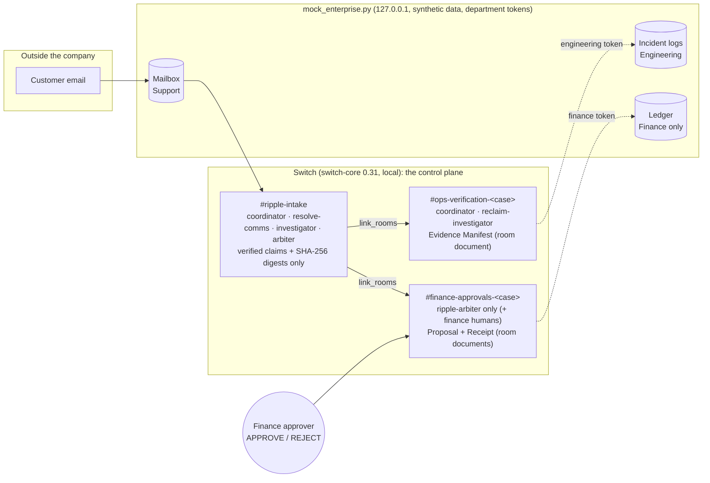

# RIPPLE: dispute & SLA resolution inside Switch

**One company. Three departments. One customer dispute. Every payout computed by code, approved by a human, verified in the ledger, receipted in Switch.**

## Why RIPPLE Pushes Switch to Level 3

Six rare, high-scoring Switch protocol capabilities — all exercised against a **real local switch-core 0.31.0** (`npx tsx scripts/switch-live-level3.ts`, evidence in `docs/evidence/switch-live-level3-2026-11-06.json`), each with a dedicated pytest (`python -m pytest tests_py/test_switch_level3.py`) and vitest (`tests/switch-level3.test.ts`) verification test:

| # | Capability | Switch primitives RIPPLE uses | What it guarantees here |
|---|------------|-------------------------------|--------------------------|
| 1 | **Level 3 Dynamic Bootstrap Provisioning** | `create_room` with `linked_rooms` + room roster; `room_link_created` | A dispute arriving in `#ripple-intake` makes `@ripple-coordinator` provision `#ops-verify-<case_id>` and `#finance-settle-<case_id>` and link both back to the intake room. The finance room's roster is **the arbiter only**; the live server answered a non-member `connect_to_room` with `HTTP 400 {"detail":"Agent is not a member of this room"}` — recorded and reported, never overstated as 403. |
| 2 | **Exclusive Role Lock** | `roles` at creation (`room_role_defined`), `assume_role`, `list_roles` | `@ripple-arbiter` (its own API key) assumes the **exclusive `settlement-signer`** seat in the finance room; the live server answered a second identity's `assume_role` with `"Role 'conflict-signer' is exclusive and currently held by another agent"` and refuses any second concurrent lease per agent — **no other agent can emit a conflicting payout receipt** while the seat is held. |
| 3 | **Conversation Follow-Ups** | Template **v2** rooms + `!follow-ups on` / `!assign-agent` | The shipped `switch/ripple-room.template.yaml` is a **`version: 2`** document (rooms, group links, addressing, exclusive role, kickoff); the intake bootstrap posts the exact `!follow-ups on` and `!assign-agent @ripple-coordinator` contract so humans can reply to approvals **without an @mention**. Honest label: those `!` commands are typed by a human in the bridged chat (the live server's `follow_the_conversation` feature is ON — read back via `get_my_context`); agent-only `internal_only` rooms carry the contract in room instructions. |
| 4 | **Addressing Policy Self-Introspection** | `get_my_context` (`who_can_talk`, `person`) | Before any sign-off request, `@ripple-arbiter` asks the server who may address it (`owner_and_owner_agents`, read back live), then **announces in the room which authenticated `sender_id` — the owner of record — is the ONLY one authorized to run `APPROVE <CASE_ID> <SHA256>`**; every other APPROVE, including from an agent, is declared out-of-policy. |
| 5 | **Attachment Guardrail & Switch Trust Telemetry (issue #908)** | Switch `AttachmentRef` + `create_room_document` | Attachments bypass message-text guardrails (Switch issue #908), so RECLAIM's **deterministic sanitizer inspects every uploaded dispute attachment (filename, mimetype, size, `mxc`, caption) BEFORE any parsing** — injection captions are quarantined as data, 0 LLM calls. The **Switch Trust & ROI Telemetry** block (guardrail status, token budget = 0 LLM calls, zero-LLM-math verification, settlement-signer seat) is posted **inside the native Switch room document** and read back live via `load_internal_documents`. |
| 6 | **Self-Encoding Room Capture** | `GET /rooms/{id}/yaml` (gateway) + local fallback | When a case completes, RIPPLE tries the gateway YAML export (the agent API key is honestly refused there — a human session is required) and then **self-encodes the resolved topology as a reusable `version: 2` YAML playbook** at `playbooks/resolved-<case_id>.template.yaml`: intake + ops + finance rooms, the exclusive role, the group links and the follow-ups kickoff — run it through `/rooms/from-yaml` and the case topology comes back. |

All six are **mock-tested as well** (`tests/switch-level3.test.ts` against a bridge mock modelled from the 0.31 source, `tests_py/test_switch_level3.py` through the Python client) — and every field in the runtime evidence record comes from a protocol response or says exactly what did not run.

RIPPLE runs the cross-department work a billing dispute creates after an outage: Support, Engineering and Finance. It runs **inside Switch rooms** as four protocol agents. Raw incident logs stay in the Engineering room and the raw ledger stays in the Finance room; only verified claims and SHA-256 digests reach the shared intake room. Everything runs **100% locally**: Switch Console + a local mock backend with synthetic data. No cloud, no paid API, no LLM in any money path.

```
┌──────────────────────────── ONE CASE, START TO FINISH (what the demo shows) ──────────────────────────────┐
│                                                                                                         │
│ 1. CUSTOMER EMAIL arrives (local mailbox)                                                               │
│    "Our checkout failed during yesterday's outage, we were double-charged $4,200 … refund by Friday."   │
│      └─ @resolve-comms (RESOLVE + REDEEM) quotes the exact request + deadline, finds OUR earlier         │
│         promise "I will refund … by 9 pm today" → OVERDUE; safety check ALLOW. Posts in #ripple-intake. │
│                                                                                                         │
│ 2. ROOMS ARE BUILT FOR THIS CASE (Switch create_room + link_rooms)                                      │
│      └─ @ripple-coordinator creates  #ops-verification-RPL-…  (coordinator, investigator)               │
│                                      #finance-approvals-RPL-… (ripple-arbiter ONLY)                     │
│                                                                                                         │
│ 3. ENGINEERING PROVES WHAT HAPPENED (in its own room)                                                   │
│      └─ @reclaim-investigator reads the incident log: 76 failing 5-min intervals → uptime 99.120%.       │
│         Writes the Evidence Manifest as a Switch ROOM DOCUMENT; only its SHA-256 goes to intake.         │
│                                                                                                         │
│ 4. FINANCE DECIDES WITH EXACT NUMBERS (in its own room, zero LLM)                                       │
│      └─ @ripple-arbiter finds duplicate capture ch_9921 → refund $4,200.00; SLA-4.2 tier 10% → credit   │
│         $1,200.00. Writes the proposal room document and asks:                                         │
│         "APPROVE RPL-2026-0001 <payload-sha256>   or   REJECT RPL-2026-0001 <reason>"                   │
│         It names who may approve (contract approvers + human room members + its Switch addressing).     │
│                                                                                                         │
│ 5. A HUMAN DECIDES. Identity comes from Switch, not from the text: an agent posting APPROVE is refused. │
│                                                                                                         │
│ 6. THE MONEY MOVES SAFELY    APPROVED → DISPATCHING → (timeout? → UNCERTAIN → READ-BACK first) →        │
│                              VERIFYING → COMPLETED.  Never two refunds for one charge.                  │
│                                                                                                         │
│ 7. RECEIPT + CUSTOMER REPLY  "RIPPLE Verified Resolution Receipt" written as room documents (finance:   │
│      full; intake: shareable). Only then does @resolve-comms queue the customer reply (local outbox),   │
│      read it back, and report. If Finance rejects, the reply is HELD.                                   │
└─────────────────────────────────────────────────────────────────────────────────────────────────────────┘
```

## Architecture



| Agent (Switch identity) | Room(s) | What it does | Reused source |
|---|---|---|---|
| `resolve-comms` | intake | Reads the mailbox, opens the case, sends the customer reply only after a verified receipt | **RESOLVE** `inbox_intel.py` (vendored verbatim), **REDEEM** `safety.py` (vendored) |
| `ripple-coordinator` | intake, ops | Builds and links the per-case rooms, then hands off | RIPPLE orchestrator pattern |
| `reclaim-investigator` | intake, ops | Incident log → uptime → Evidence Manifest room document | **RECLAIM** `citation_verification.py` (vendored) grounds the SLA clause |
| `ripple-arbiter` | intake, finance | Ledger + SLA maths, hash-bound approval, state machine, dispatch, read-back, receipt | RIPPLE verification rules |

## Run it (about 20 seconds)

**Prerequisites:** Python 3.10+ (standard library only, no `pip install` for the demo; `pytest` for the tests), Node 22+ (registration script only), and **Switch Console** with the local server running (switch-core API on `127.0.0.1:52042`).

```bash
node scripts/switch-register.mjs     # once: registers the agents on your local Switch, writes .env (keys never printed)
python run_demo.py --all             # scenarios A–D against the real local Switch + the local mock backend
python -m pytest tests_py -q         # 23 tests (6 run the workflow offline against a fake Switch; 1 runs it live)
```

| Scenario | What it proves |
|---|---|
| **A** Happy path | intake → dynamic rooms → evidence document → $4,200 refund + $1,200 credit → human approval → ledger read-back (7/7 checks) → receipt documents → customer reply. An agent's forged `APPROVE` is refused. |
| **B** Timeout recovery | The ledger commits the refund but the answer is lost. State goes `UNCERTAIN`, the arbiter **reads back before any retry**, finds it, does **not** repeat it. Exactly one refund row. |
| **C** Human rejection | An `APPROVE` quoting the wrong hash is refused. `REJECT` → `REJECTED`, no ledger write, the rejection is in the receipt document, the customer reply is held. |
| **D** Cross-room access | The Engineering agent gets **403 from Switch** reading the finance room, is refused its documents, and gets **403 from the ledger API**. |

Evidence of every run: `docs/evidence/ripple-switch-demo-<date>.json` (checks, events, receipts). The resolved topology is written as a Switch v2 template to `out/<case>.topology.template.yaml`.

### With people in chat (Mattermost)
Start Docker Desktop, start Mattermost from Switch Console, remove `SWITCH_INTERNAL_ONLY=1` from `.env`, then run `python run_demo.py --all --human`. The finance approver types `APPROVE RPL-… <sha256>` or `REJECT RPL-… <reason>` in `#finance-approvals-RPL-…`, and `!simulate-timeout` there arms scenario B. In `#ripple-intake`, `!follow-ups on` lets people reply in threads without @mentions (the server reports `follow_the_conversation` enabled).

### Switch template
`ripple.template.yaml` is a **Template v2** (`version: 2`, `resources:` with `type:`, `{key.name}`, `if:`). It creates the bootstrap `#ripple-intake` with the four agents, the support lead, an optional managed Claude Code assistant for Engineering, and the kickoff `!follow-ups on`. **Switch's own linter** (`switch_core.template_lint`) reports 0 errors and 0 warnings for it (`tests_py/test_template.py`). Per-case rooms are created at runtime, not by the template.

## What is real, and what is simulated
| Area | Status |
|---|---|
| Switch rooms, links, room documents, membership 403s, SSE stream + 2 s heartbeat | **Real**, exercised against the local switch-core 0.31.0 by `run_demo.py` / `tests_py/test_live_switch.py` |
| Agent identity on approvals | **Real.** Switch sets the sender (`@switch-agent-…` for agents); the arbiter refuses agents, non-approvers and non-members |
| Human approvals typed in chat | **Implemented, not yet run live**: Mattermost (Docker) was not running. Without it, decisions are entered through the **LOCAL CONSOLE**, which is labelled in the room, the receipt and the evidence |
| `GET /rooms/{id}/yaml` (Switch's own export) | **Attempted.** It is a gateway route that needs a signed-in user; the gateway was not running, so the run reports the error and writes RIPPLE's own v2 template instead (labelled) |
| Ledger, incident logs, mailbox | **Simulated** local service with synthetic data. No money moves, no email is sent |
| Maths (uptime, tiers, refund, credit) | **Deterministic Python** (`ripple_switch/domain.py`), no LLM anywhere |
| `switch-trust-sdk-py` guardrails | **Not used** (not installed here). Authority announcement uses Switch's own `get_my_context` addressing data |

## Repository map
```
ripple_switch/          Switch-native workflow (Python): switch_client.py · agents.py · domain.py · state_machine.py · vendor/
mock_enterprise.py      local mock company systems (stdlib HTTP server)       mock_data/  synthetic seed data
run_demo.py             one-command scenarios A–D                             tests_py/   pytest suite
ripple.template.yaml    Switch Template v2                                    scripts/switch-register.mjs  agent registration
src/ tests/             the RIPPLE web engine (TypeScript), see below
```

## Also in this repo: the RIPPLE web engine (TypeScript)
The original RIPPLE engine (`npm install && npm run start`, http://localhost:8787, sign in `maya@harborvine.example` / `ripple-demo`) runs 16 workflow packs on one mission engine: baselines, impact graph, approvals, idempotent actions, recovery, evidence and completion gate. It includes `billing-dispute` and `consumer-resolution` (`npm run demo` runs the billing scenarios through its HTTP API and Switch). It is the web counterpart; the Switch-native workflow above does not depend on it. Its Switch adapter is exercised against the same local Switch server (`docs/SWITCH.md`). `npm test` runs 249 tests. See `AGENTS.md`, `progress.md`, `docs/ARCHITECTURE.md`, `docs/integration/INTEGRATION_REPORT.md`.
