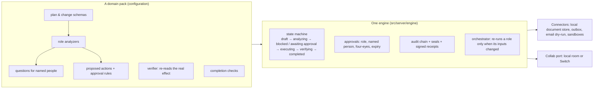

# RIPPLE

**One change → every consequence found → every responsible person asked → every approved action independently verified.**

RIPPLE is one workflow engine with one data model, one approval and evidence ledger, and **20 domain packs** that are
configuration, not separate apps: catering, film, agency scope, invoices, shift handover, moves, podcasts, submissions,
incidents, schema changes, payouts, bug fixes, offers, revenue recovery, consumer disputes, billing & SLA, deploy gates,
PR review, event run-of-show, and (new) **Package Gate**, a supply-chain check for `npm install` / `pip install` lines.

Every number on this page was produced by a command in this repository. Each one says where it comes from and when it
was last run. Anything that was not run is labelled.

## What has been validated (2026-11-07)

| Claim | Evidence | Last run |
|---|---|---|
| The TypeScript engine and all 20 packs pass their tests | `npx vitest run` → **44 files, 364 tests passed**; `npm run typecheck` 0 errors; `npm run lint` 0 problems | 2026-11-07 |
| The browser journey across packs works | `node scripts/e2e-crossdomain.mjs` → `CROSS-DOMAIN JOURNEY PASSED` (8 packs, one Control Center, one approvals queue, no console errors) | 2026-11-07 |
| The Python Switch-native workflow's tests pass offline | `python -m pytest tests_py -q` → **27 passed, 2 skipped** (the 2 need a running Switch server) | 2026-11-07 |
| Package checks detect malicious npm packages from registry metadata | **93.9%** [92.8–94.9] of 1,973 held-out malicious packages at their first malicious publish; **58.8%** averaged over their live window; 0.0% of 673 popular packages flagged, **15.4%** of fresh legitimate packages flagged | 2026-11-07, `docs/benchmarks/PACKAGE_RISK_BENCHMARK.md` |
| Switch protocol primitives work against a real server | linked rooms, exclusive roles, `get_my_context`, room documents, isolation refusals on switch-core 0.31.0 (`docs/evidence/switch-live-level3-2026-11-06.json`) | 2026-11-06 (**not re-run** on 2026-11-07: no Switch server in this environment) |

Not validated: Mattermost-bridged rooms with humans typing in chat; Switch's gateway YAML export with a human session;
any Package Gate run on a Switch server; any production connector (all connectors are local or dry-run by design).

## How it works (one engine, packs as configuration)



- An action is `verified` only after the engine re-reads its effect; a mission completes only when every completion
  check passes. Agents never set those states.
- A new domain is a new pack. Session 18 added `package-gate` with no change to the engine.
- What is missing: links **between** missions in different packs (for example, a denied package blocking a deploy gate).
  See `docs/AUDIT-2026-11-07.md`, section D.

## Package Gate (new): Scout, Inspector, Squat Watch, Fixer


A coding agent posts `npm install express expresss chalk-pretty-log react-forms-validator-pro`. RIPPLE:

1. **Scout** parses the install line (npm, yarn, pnpm, bun, npx, pip, uv, poetry, pipenv) and applies the metadata and
   lookalike-name rules to what the registry recorded: `expresss` is one edit from `express` and 1 day old.
2. **Inspector** reports the static code reading of the archive, read in memory only (never installed, extracted to
   disk or run). A flagged package with no code reading is "not inspected", never clean.
3. **Squat Watch** removes the invented name (`react-forms-validator-pro` does not exist), counts how often the room
   asked for it, and raises it if it later appears on the registry.
4. **Fixer** holds the gate: `chalk-pretty-log@0.1.0` (3 days old) waits for the security lead, and the decision binds
   to that exact version (a new version is a new question). After the decision it drafts the safe line (with the
   package denied: `npm install express@5.1.0 express`) and a receipt of everything stopped. Only
   the mapped person can answer; a manager is refused. The verifier re-parses the posted line and fails it if any
   package in it is not clean, approved for its exact version, or the real target of a lookalike.

Code: `src/server/capabilities/pkgguard/` (pure functions) and `src/server/packs/pkggate/pack.ts`. Tests:
`tests/pkggate.test.ts` (20).

### Measured detection (held-out 70%, rules frozen before evaluation)

| Detector | npm | PyPI |
|---|---|---|
| Metadata, at first malicious publish | **93.9%** recall | not recoverable: PyPI deletes removed projects |
| Metadata, averaged over the live window | **58.8%** | — |
| Static code reading (score ≥ 4) | **3.2%** (n=185) | **50.0%** (n=32) |
| Either signal (same 185 npm packages) | **96.8%**; 6 missed by both | — |
| Legitimate flagged by metadata | popular 0.0%, long-tail 1.9%, **fresh 15.4%** | popular 0%, random 2.3%, **fresh 43.8%** |
| Legitimate flagged by code (≥ 4) | 1.5% | 3.5% |
| Lookalike names: recall / false alarms | 0.1% / 0.7% | 6.6% / 0.4% |

What the numbers say: on npm, almost all reported malware is a brand-new, one-version package, so registry metadata is
the detector and code reading adds little; the cost is that fresh legitimate packages are flagged too, so the gate asks
a person instead of blocking. The weak spot is a malicious version pushed to an established package (only 32.7% caught).
Data: OSV/OpenSSF malicious-package reports (222,872 npm, 11,971 PyPI), npm placeholder timestamps, npm search and PyPI
index controls. Full method, provenance, confusion matrices and limitations: `docs/benchmarks/PACKAGE_RISK_BENCHMARK.md`.
Recompute offline: `npx tsx bench/pkgguard/05-evaluate.ts heldout`.

## Run it

```bash
npm install
npm run start          # builds the web app and serves http://localhost:8787 (sign in maya@harborvine.example / ripple-demo)
```

```bash
npm test               # vitest: engine, 20 packs, API, Switch adapter against a mock
```

```bash
npm run typecheck && npm run lint
```

```bash
python -m pytest tests_py -q   # the Python Switch-native billing workflow, offline
```

The Switch-native billing & SLA dispute workflow (four Switch agents, per-case rooms, hash-bound human approval,
read-back before retry) and its live-Switch instructions are in `docs/SWITCH_NATIVE_WORKFLOW.md` (the previous README).

## Repository map

```
src/server/engine/        state machine, orchestrator, approvals, verification, completion (pack-agnostic)
src/server/packs/         20 workflow packs (configuration)          src/server/capabilities/  pure shared capabilities
src/server/collab/        local room + Switch adapter                 src/server/connectors/    local / dry-run connectors
src/web/                  React UI (renders server read models)       tests/                    vitest
bench/pkgguard/           package-risk benchmark harness + committed data   docs/benchmarks/  benchmark reports
ripple_switch/ tests_py/  Python Switch-native workflow + pytest      docs/evidence/            run evidence and screenshots
```

Further reading: `AGENTS.md` (rules for contributors and agents), `progress.md` (session log), `docs/ARCHITECTURE.md`,
`docs/SWITCH.md`, `docs/AUDIT-2026-11-07.md` (this session's audit), `docs/TESTING.md`.
