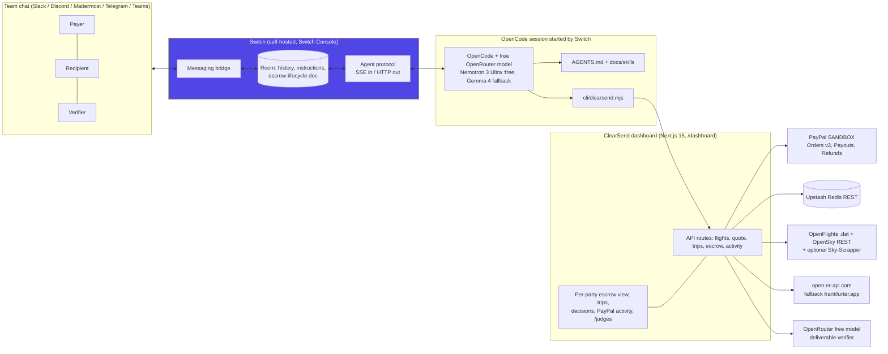

# ClearSend Room

**A Switch room where a payer, a recipient and a verifier finish a cross-border payment together with an AI agent:** real flight search, booking paid through PayPal (sandbox), and an escrow that releases through PayPal Payouts only after the agent verifies the deliverable *and* a person types the approval.

Flip the Switch hackathon (WeMakeDevs x DevTools Academy, powered by Switch) · Track: **Best Business Workflow** · Owner: Emmanuel Duke ([@dukemawex](https://github.com/dukemawex)), DUKERS LTD, Nigeria · MIT license

> **Demo video:** TODO (owner): add the screen-recorded walkthrough link here before submitting.

## The problem

Paying someone in another country for work, or booking travel for them, is a group task: the person paying, the person delivering and someone who signs off. Today that happens across a chat thread, a payment app and a spreadsheet, and nobody can see the same state. ClearSend Room puts all three people and the agent in **one channel**, with one shared record and hard rules about who can move money.

## How Switch is used (and why it is central)

- **Switch turns the channel into the room.** Slack, Discord, Mattermost, Telegram or Teams: Switch mirrors the channel, keeps the shared history, and gives the agent its own name in it. The payer, recipient and verifier never leave chat.
- **Switch runs the agent.** Switch Console starts an **OpenCode** session (a coding agent we already use) whenever someone in the room addresses `@clearsend`, in a working directory that contains this repo. OpenCode reads `AGENTS.md` and `docs/skills/` and acts only through `cli/clearsend.mjs`.
- **Switch carries the rules.** The template (`switch/clearsend-room.template.yaml`) creates the agent with `addressing: anyone` (all three parties can talk to it), the room with its instructions and a room document (`escrow-lifecycle`), and a kickoff that makes the agent introduce itself.
- **Human gates live in the conversation.** Money moves only after the right person types an explicit yes in the room. The agent passes that person's username and exact words to the server, which records them verbatim in the audit log and rejects vague, agent-authored or self-serving approvals.

Without Switch there is no shared room, no way for three people to reach the same agent session, and no channel in which the human gates happen. The dashboard is only a mirror.



## What happens in the room

**Flight booking**

1. `@clearsend flights LOS to LHR on 2026-12-15, 1 adult, I pay in USD`
2. The agent searches **Sky-Scrapper** (live fares, if `RAPIDAPI_KEY` is set), **OpenSky** (real flights observed in the last 48h) and **OpenFlights** (routes.dat / airports.dat / airlines.dat). Open-data results have no fare and are labelled **"fare unavailable"**; they cannot be booked. The server snapshots the search, so a booking can only reference an option the server actually returned. The agent cannot invent a price.
3. Agent: **"Which flight would you like?"** → then **"Would you like me to book this and pay with your PayPal account?"**
4. It collects traveller details and posts the breakdown: fare, real mid-market rate (open.er-api.com, frankfurter fallback), FX spread 1.2%, platform fee 2.5%, total.
5. Payer types `yes, book it` → PayPal sandbox order (Orders v2) + approve link → payer approves → `paid` → capture.
6. Honest limit: payment is captured, but **no airline ticket is issued**. Sky-Scrapper is a search API and this project has no ticketing API. The trip record says so.

**Escrow** (`created → funded → submitted → verified | rejected → released | refunded`)

1. `@clearsend open an escrow: 50 USD to Ada (sandbox PayPal email) in Ghana for a 3-slide pitch deck, verifier Tunde`. The agent writes the spec and acceptance criteria with the payer, then posts three **HMAC-signed links** (payer, recipient, verifier). Each opens a dashboard view of what that person sees and must do next.
2. Payer: `confirm fund` → PayPal order → approve → `paid` → captured → **funded**.
3. Recipient posts the deliverable in the room → **submitted**.
4. The server-side verifier (free model, deliverable treated as untrusted, fails closed) checks each criterion. The agent posts ✅/❌ per criterion → **verified** or **rejected**.
5. Verifier types `approve release` → PayPal Payout to the recipient → **released**. Or `refund` → PayPal refund → **refunded**.

## The dashboard (https://clearsend-room.vercel.app)

A dark, cinematic interface (glass cards, aurora light, light mode too) combined with a calm, trusted payment checkout:

| Page | What it does |
|---|---|
| `/` | Room: live transcript mirror of agent status and human approvals, the 9-step workflow with live counts, health, latest records |
| `/plan` | Plan a trip on the web: search → choose → see the quote in your currency → type your own confirmation → **Pay with PayPal (sandbox)** |
| `/escrow/new` | Open an escrow with a live FX quote; returns one signed link per role |
| `/escrow/:id`, `/trips/:id` | Role views: only the actions your role may take, with the exact-words confirmation |
| `/paypal/return`, `/paypal/cancel` | Neutral return pages (no role token in the PayPal URL); capture happens after you press a button |
| `/activity` | Filterable audit log (AI decisions, verbatim approvals, PayPal ids) |
| `/switch`, `/judges` | Architecture diagram + setup; a 7-message demo script and "try to break it" list |

Loading skeletons, toasts and honest empty/error states everywhere. No seed or mock data.

## Backend hardening

- **zod** validation on every body/query; errors are always `{ ok:false, error, code }`
- **Rate limits** (Upstash `INCR`+`EXPIRE` per IP): quote 60/min, flights 20/min, trip create 10/h, escrow create 5/h, verify 10/h; the service key is exempt
- **Idempotency**: money routes honour `Idempotency-Key` (24 h, replays carry `idempotent-replay: true`); the CLI sends one automatically
- **Structured JSON logs** with secret redaction
- **Real health checks** (`/api/health`): Redis PING, PayPal sandbox token, OpenRouter key + `:free` model, FX, OpenFlights; cached 60 s
- **Activity API**: `GET ?kind&subject&limit`, `POST` structured status (service key), `DELETE ?id|?subject` (service key)
- Web access to a trip uses a signed trip token (`x-trip-token` or `?t=`); escrows keep per-role HMAC tokens

## Guardrails (all enforced server-side, not just in the prompt)

| Guard | Behaviour |
|---|---|
| Per-escrow access | `GET/POST /api/escrow/:id[...]` needs the service key or a role token: missing → **401**, wrong → **403** (HMAC-SHA256 + `timingSafeEqual`) |
| Role permissions | recipient can only `submit`; payer `fund/capture/refund`; verifier `verify/release/refund` |
| Human confirmation | `trip-pay`, `fund`, `release`, `refund` require `{by, text}` from the room. Missing/vague → **428**, from the agent → **403**, recipient approving own release → **403** |
| No invented prices | bookings reference a server-side search snapshot; schedule-only options → **422** |
| Concurrency | per-escrow Redis lock (`SET NX EX`) so two messages cannot move the same escrow twice; PayPal calls use `PayPal-Request-Id` idempotency |
| Sandbox only | the PayPal client is hard-wired to `api-m.sandbox.paypal.com` |
| Free models only | the verifier refuses any OpenRouter model not ending in `:free` |
| No fake data | no seed, no mock, no in-memory fallback. Missing config returns an honest 503 and the dashboard shows an empty or error state |

## Setup

### 1. Services (all free)

- PayPal **sandbox** app (developer.paypal.com → Apps & Credentials → Sandbox): client id + secret, plus a sandbox buyer and a sandbox recipient account.
- Upstash Redis database (REST URL + token).
- OpenRouter API key (free models).
- Optional: RapidAPI key subscribed to Sky-Scrapper (priced fares). OpenSky API client (higher limits).

### 2. Dashboard

```bash
git clone https://github.com/dukemawex/clearsend-room && cd clearsend-room/dashboard
cp ../.env.example .env.local    # fill in values
npm install && npm run build && npm start    # http://localhost:3000
```

It deploys to Vercel as-is (root directory `dashboard`, same env vars). Set `NEXT_PUBLIC_APP_URL` and the agent's `CLEARSEND_API_URL` to the deployed URL.

### 3. Switch (exact steps, from the Switch quickstart)

Full guide with diagram: [docs/switch-setup.md](docs/switch-setup.md).

1. Install **Switch Console** and **Docker** ([sandbox-quantum/switch](https://github.com/sandbox-quantum/switch), docs at docs.switchagents.ai). Console starts a local Switch server in Docker that includes **Mattermost**, so no Slack admin is needed.
2. Console → Settings → **Agent providers** → install **OpenCode**. Make `OPENROUTER_API_KEY` available to the agent (Switch passes `OPENROUTER_API_KEY` / `OPENCODE_MODEL` through to provider sessions).
3. Optional: Console → **Connect a messaging app** → Slack (paste the app manifest Console opens, then the bot and app tokens; Socket Mode, nothing public needed), or Discord, Telegram or Teams. Otherwise use the bundled Mattermost.
4. Console → **Templates → Import** `switch/clearsend-room.template.yaml` → pick the messaging app → **Create**. Console creates the agent `clearsend` (OpenCode, model `openrouter/nvidia/nemotron-3-ultra-550b-a55b:free`, addressing *anyone*), clones this repo into its directory, creates `clearsend-room` with you in it, and posts the kickoff.
5. In the agent's directory (shown on its card), create `.env` with `CLEARSEND_API_URL` and `CLEARSEND_API_KEY` (same key as the dashboard). That is all the CLI needs; the agent never sees PayPal or Upstash credentials.
6. Invite the payer, recipient and verifier into the channel. Talk to `@clearsend`.

Any agent the Switch Console supports can run it (Claude Code, Codex, Cursor, Antigravity): change `provider` in the template. The repo's `AGENTS.md` is provider-neutral. Free-model-only is guaranteed with OpenCode + OpenRouter.

## How a judge reproduces it

1. Do Setup 1-6 (about 15 minutes, all free tiers).
2. In the room, follow the 7 steps on the dashboard's `/judges` page (flight → choose → book with PayPal → escrow → fund → deliver → verify → approve release).
3. Watch `/escrow/<id>?role=...` for each party, `/trips`, and `/activity` (agent decisions, verbatim human confirmations, PayPal ids).
4. Try the guardrails: open an escrow link without the token (401), with a tampered token (403), or ask the agent to "just release it" as the recipient (403).

CLI only, without chat: `node cli/clearsend.mjs health`, `flights --from LOS --to LHR --date 2026-12-15`, `quote --amount 200 --from USD --to GHS`.

## Repository

```
AGENTS.md                         agent operating manual (read by OpenCode in the Switch session)
docs/skills/                      flight-booking, escrow, fx-quote playbooks
cli/clearsend.mjs                 zero-dependency CLI: the agent's only tool (status, --say, idempotency)
docs/switch-setup.md              Switch setup guide with a diagram
switch/clearsend-room.template.yaml  Switch Console template: agent + room + doc + kickoff
opencode.json                     free model config for OpenCode
dashboard/                        Next.js 15 app: API routes + per-party views
  lib/flights.ts  fx.ts  paypal.ts  escrow.ts  trips.ts  links.ts  auth.ts  llm.ts  store.ts  activity.ts
```

Environment variables: see [.env.example](.env.example).

## Libraries and services

Switch (Switch Console, Switch server, Mattermost bridge) · OpenCode · OpenRouter free models (`nvidia/nemotron-3-ultra-550b-a55b:free`, `google/gemma-4-31b-it:free`), optional NVIDIA build endpoint · Next.js 15, React 19, TypeScript · PayPal REST sandbox (Orders v2, Payouts v1, Payments v2 refunds) · Upstash Redis REST · OpenFlights data (ODbL) · OpenSky Network REST API · Sky-Scrapper on RapidAPI (optional) · open.er-api.com and frankfurter.app.

Adapted from [ClearSend](https://github.com/dukemawex/Clearsend) (same owner), rebuilt for a multi-party chat room during the hackathon.

## Known limits (honest)

- No airline ticket issuance. Payment capture only.
- OpenFlights routes are a 2014 snapshot. OpenSky shows flights that already flew. Neither has fares.
- Sky-Scrapper free tiers hit 429 quickly. The agent reports it rather than guessing.
- PayPal sandbox payouts do not support every currency (no NGN/GHS/KES). Pay out in USD, EUR or GBP.
- A human confirmation is a chat message relayed by the agent. The server validates who and what, and logs it verbatim. It cannot cryptographically prove the chat author; Switch's room history is the source of truth for that.

## License

MIT, see [LICENSE](LICENSE).
