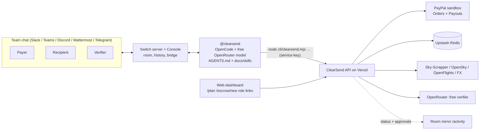

# Switch setup for ClearSend Room

[Switch](https://github.com/sandbox-quantum/switch) turns a team chat channel into a room where people and AI agents work together. ClearSend is one agent in that room.

## Steps

1. Install Docker and the Switch Console (from the Switch releases). Console starts a local Switch server (Mattermost included) or connects to yours.
2. Console → Agent providers → **OpenCode**. Switch passes `OPENROUTER_API_KEY` and `OPENCODE_MODEL` to the agent session; use a model ending in `:free`.
3. Optional: connect Slack, Teams, Discord or Telegram in Console.
4. Templates → **Import** `switch/clearsend-room.template.yaml` → choose the app → Create. It creates `@clearsend`, clones this repo as its workspace, creates `#clearsend-room` with the `escrow-lifecycle` doc, and posts the kickoff.
5. In the agent's directory, create `.env` with `CLEARSEND_API_URL` and `CLEARSEND_API_KEY`. The agent never holds PayPal, Upstash or OpenRouter verifier secrets.
6. Invite the payer, recipient and verifier, then follow the demo on `/judges`.

## What the agent posts

After each step the agent runs `node cli/clearsend.mjs status --subject <id> --step <step> --summary "…"`. The dashboard home page shows these as a live transcript and moves the 9-step stepper. Human approvals are stored word for word with the name of the person.
